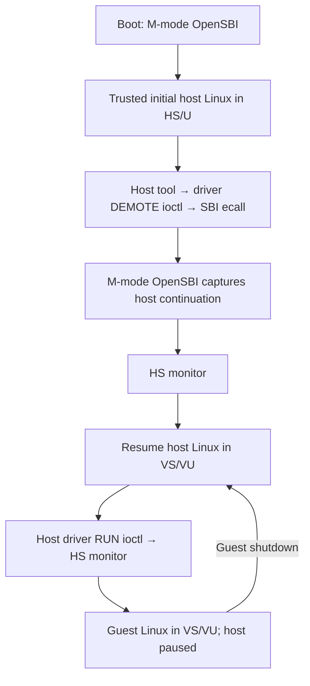

# Runtime architecture

Dongtian transfers a running Linux host from native HS mode into VS mode, under an HS monitor, then runs one independent protected Linux guest. The two Linux domains use the same unmodified kernel image and separate initramfs and CPU RAM mappings.

| Entity | Role |
| --- | --- |
| M-mode OpenSBI | Machine firmware and the local handoff extension; captures the native host continuation and enters the monitor |
| HS monitor | Owns G-stage mappings and switches between host and guest |
| VS/VU host Linux | Original kernel and userspace, resumed after handoff; owns the control driver and management tool |
| VS/VU guest Linux | One preloaded protected guest, with its own kernel execution and userspace |

The Linux driver and management tool are host components, not additional security domains. Before handoff, host Linux runs in native HS and its userspace in U mode. After handoff, its kernel/userspace run in VS/VU. M-mode OpenSBI and the HS monitor form the trusted monitoring stack.

The host is not rebooted during DEMOTE: it resumes the same driver invocation with virtualized execution state. RUN suspends that host, starts the guest, and returns to the host when the guest shuts down. There is one hart and one guest execution/return cycle per QEMU session. UART and PLIC are shared; host and guest do not run concurrently.

## Trust and implementation scope

The initial HS host and the preloaded images are trusted. The initial host can access guest data before handoff. Separate post-handoff CPU mappings and the private-read denial check do not establish secure boot, protection from an arbitrary malicious initial host, or device/DMA isolation. See [execution scope](LIMITATIONS.md).

This runtime expands the compact public monitor with real OpenSBI integration, a kernel module, and management tools; it is not a direct pruning of the complete historical project. The dependency manifest pins upstream OpenSBI 1.7 at `a32a91069119e7a5aa31e6bc51d5e00860be3d80` and preparation adds the local SBI extension.

See [the handoff and SBI boundary](BOOT_AND_SBI_BOUNDARY.md) for addresses, ABI details, and state preservation, and [validation](VALIDATION.md) for the existing execution evidence.
